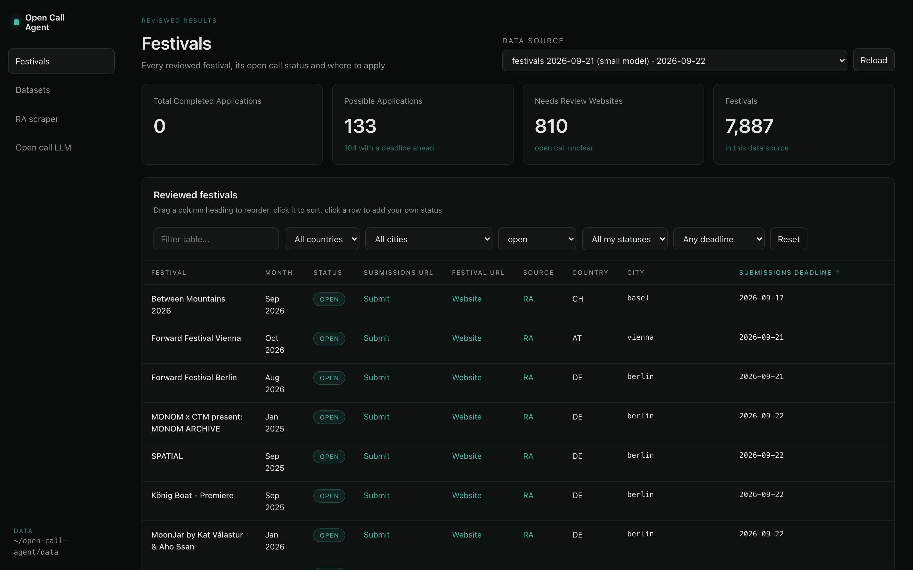
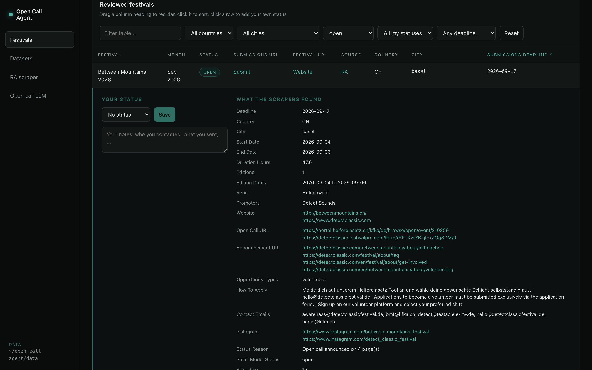
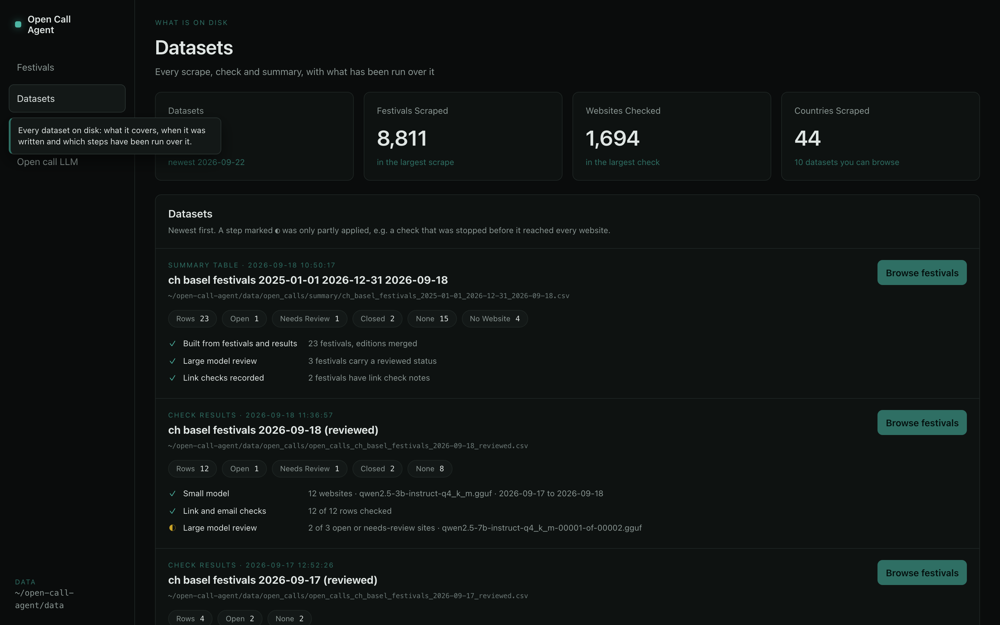
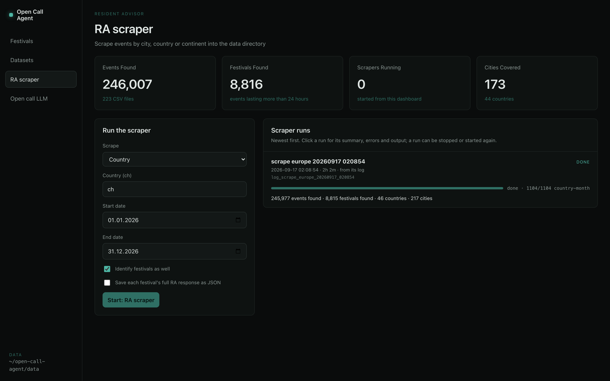
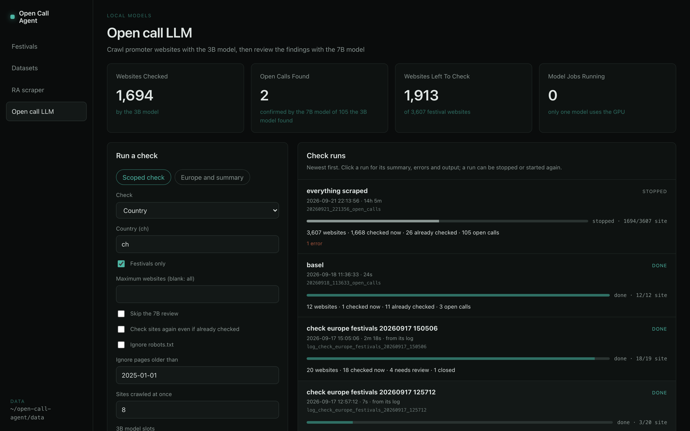
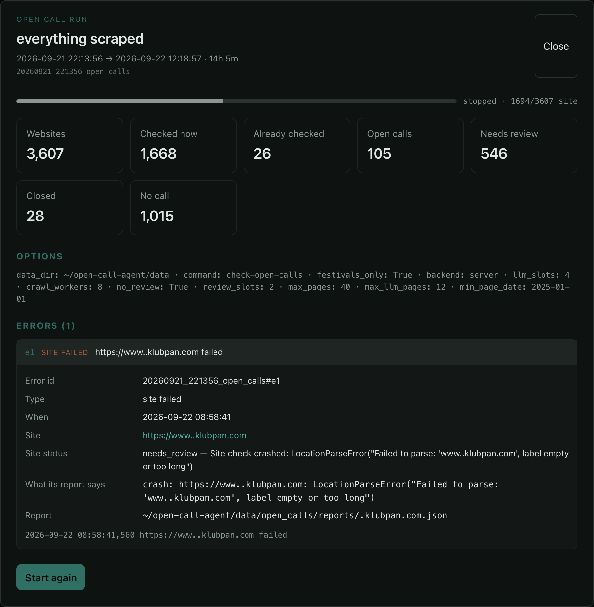

# open_call_agent

**Finds festivals that are currently inviting people to apply — to play, DJ, perform, show work, run a workshop or
volunteer — and puts them in one table with the link to apply and the deadline.**

It scrapes events from [ra.co](https://ra.co), works out which ones are festivals, crawls each festival's own website,
and reads those pages with two local LLMs to decide whether a call is open. Everything runs on your machine; no API
keys, no data sent anywhere.



---

## What it does

Three parts, each usable on its own. Every stage writes files that the next one reads, so you can stop after any of
them, re-run one alone, or pick the work up days later.

```
  ra.co GraphQL                 the festival's own website              your browser
        │                                   │                                 │
        ▼                                   ▼                                 ▼
┌────────────────┐            ┌──────────────────────────┐          ┌──────────────────┐
│  1. SCRAPER    │            │  2. OPEN CALL CHECKER    │          │  3. DASHBOARD    │
│                │ festivals  │                          │ results  │                  │
│ events, venues │──────────▶ │ crawl → 3B model → links │ ───────▶ │ browse, filter,  │
│ promoters,     │   CSV      │      → 7B review         │   CSV    │ take notes, run  │
│ links          │            │                          │          │ and watch jobs   │
└────────────────┘            └──────────────────────────┘          └──────────────────┘
```

### 1. The scraper

Pulls events from RA's GraphQL API by city, country or whole continent.

- Keeps the **festival's own website and Instagram** (RA's `promotionalLinks`) separately from the promoter's, because
  one promoter site can cover dozens of different events.
- Anything **longer than 24 hours is a festival** — that single rule is what separates a festival from a club night.
- Scale, for reference: Europe over two years is about **246,000 events → 8,800 festivals** across 44 countries.

### 2. The open call checker

For each festival website: a crawler, then two local models, then a round of link checking.

- **Crawl** — robots.txt and sitemaps first, then a priority-first crawl. Pages that look JavaScript-rendered or
  blocked are re-fetched in headless Chromium. Site-wide menus and footers are stripped, so a nav item saying
  "Open Call" doesn't flag every page.
- **Classify** — Qwen2.5-3B-Instruct reads the shortlisted pages and returns a status, a deadline, how to apply and
  the quotes that prove it.
- **Verify** — a quote that isn't on the page *verbatim* is thrown out, and a deadline in the past closes the call.
  The model's claim alone is never enough.
- **Review** — Qwen2.5-7B-Instruct re-reads everything the 3B model called `open` or `needs_review`, this time with
  the application form's text alongside the announcement, and decides the final status.
- **Check the links** — every URL and email is pinged, and application links are opened in a browser to catch portals
  that answer `200 OK` and then redirect, or forms that say they have closed. **A call whose forms are all closed is
  closed**, whatever the page says.

### 3. The dashboard

A local page for reading the results and running the other two parts: browse and filter the festivals, keep your own
application status against each one, start and stop jobs, and see what every past run did. No framework and no build
step — plain HTML, CSS and JavaScript on Python's standard-library HTTP server.

---

## Setup

```bash
conda env create -f environment.yml
conda activate open-call-agent
poetry install
playwright install chromium
```

The models (Qwen2.5-3B and 7B Instruct, Q4_K_M GGUF, ~6.4 GB together) download to the Hugging Face cache the first
time you run a check.

---

## Usage

Country and city codes are the ones in ra.co URLs, e.g. `ra.co/events/ch/zurich`. `scrape` takes the pair together
(`--city ch/zurich`); the other commands take them apart (`--country ch --city zurich`).

Every command also takes `--data-dir` (default `data/`, or `$OPEN_CALL_AGENT_DATA_DIR`) and `-v` for debug logging.

### Scrape events

```bash
open-call-agent scrape --country ch --start 2026-09-16 --end 2026-09-18 --festivals
open-call-agent scrape --city ch/zurich --start 2026-09-16 --end 2026-09-18
open-call-agent scrape --continent europe --start 2025-01-01 --end 2026-12-31
```

- `--country` / `--city` / `--continent` — pick exactly one.
- `--start`, `--end` — inclusive, `YYYY-MM-DD`. Required.
- `--festivals` — also write a festivals CSV next to each events CSV.
- `--save-raw` — keep RA's full response per festival as JSON, so a column added later can be filled from disk
  instead of scraping again.

### Identify festivals in CSVs you already have

```bash
open-call-agent festivals --country ch
```

- `--country`, `--city` — limit which CSVs are read (`--city` needs `--country`).
- `--min-hours` — how long an event must last to count as a festival. Default `24`.

### Check websites for open calls

Runs the 3B model over every website, then the 7B review, then the link checks.

```bash
open-call-agent check-open-calls --country ch --festivals-only
open-call-agent check-open-calls --festivals-only --limit 20        # everything scraped, trial run
```

**What to check**

- `--country`, `--city` — limit which CSVs are read (`--city` needs `--country`). With neither, everything scraped
  is checked.
- `--festivals-only` — only festival websites, not every event's.
- `--limit` — stop after this many websites.
- `-o`, `--output` — where the results CSV goes.

**How thoroughly**

- `--max-pages` — pages fetched per site. Default `40`.
- `--max-llm-pages` — pages classified per site. Default `12`.
- `--min-page-date` — skip pages last changed before this date; pages without a date are read anyway. Default
  `2025-01-01`, `none` to read everything.
- `--ignore-robots` — fetch pages robots.txt asks automated visitors not to. Many festival sites block everything by
  default.

**Models and speed**

- `--crawl-workers` — websites crawled at once. Default `8`.
- `--llm-slots` — parallel sequences for the 3B model. Default `4` (fastest in benchmarks; 8 gave nothing back).
- `--review-slots` — parallel sequences for the 7B model. Default `2`.
- `--no-review` — skip the 7B pass.
- `--no-reuse` — check sites again even if the same model already did.
- `--model-path`, `--review-model-path` — your own GGUF files.
- `--backend server|local` — `server` runs llama-server with continuous batching (default); `local` runs in-process,
  one call at a time.

### Review an existing results CSV

```bash
open-call-agent review-open-calls --input data/open_calls/open_calls_ch_festivals_2026-09-18.csv
```

- `--input` — a results CSV from `check-open-calls`. Required.
- `-o`, `--output` — default `<input>_reviewed.csv`.
- `--no-reuse`, `--ignore-robots`, `--min-page-date`, `--review-model-path`, `--review-slots` — as above.

### Check a single website

```bash
open-call-agent check-site -u https://fogstudio.ch --ignore-robots
```

- `-u`, `--url` — the website. Required.
- `-o`, `--output` — write the full JSON report here.
- Takes the same crawl options: `--max-pages`, `--max-llm-pages`, `--min-page-date`, `--ignore-robots`,
  `--model-path`.

Prints the status and why, the deadline, the pages that mention a call with their verified quotes, and what the crawl
did and didn't reach.

### Whole continents

```bash
python scripts/scrape_europe.py                        # 2025-01-01 to 2026-12-31, resumable
python scripts/check_europe_festivals.py --limit 20    # check, then write the summary tables
python scripts/check_europe_festivals.py --summary-only
```

- `--continent` — `europe` (default), `africa`, `asia`, `north_america`, `oceania`, `south_america`.
- `--period` — which scrape to check, as it appears in the festival CSV names, e.g. `2025-01-01_2026-12-31`.
- `--summary-only` — rebuild the summary tables from the latest results without checking anything.
- Plus `--limit`, `--no-review`, `--no-reuse`, `--ignore-robots`, `--min-page-date`, `--crawl-workers`,
  `--llm-slots`, `--review-slots`.

> These are long jobs. A full European check is hours of GPU time.

### Stopping and resuming

Press **Ctrl+C**, or `kill <PID>` — both are handled the same way.

- Every site either model has finished is already written to the CSV and to its own JSON file.
- The model server is shut down cleanly, so the GPU is released.
- Run the same command again to carry on: sites already checked **by the same model file** are skipped. Changing
  models re-checks everything, on purpose.
- Don't run two model jobs at once — only one model should hold the GPU.

---

## Dashboard

```bash
open-call-dashboard --open          # http://localhost:8000
```

- `--data-dir` — which data directory to read. Default `data/`, resolved to an absolute path and shown in the sidebar.
- `--host`, `--port` — default `127.0.0.1:8000`.
- `--open` — open a browser once it is up.

Hovering for a second over anything you can act on explains what it does.

> **Localhost only.** It has no authentication and it starts processes. Don't expose it to a network.

### Festivals

The table at the top of this README. One row per festival, with the columns you can drag, sort and filter by text,
country, city, status, your own status and deadline.

**Click a row** and it opens into everything the scrapers found for that festival, with your own status and notes
beside it:



- Your statuses (*interested, applied, accepted, rejected, not a festival, ignored*) and notes live in
  `data/dashboard/notes.json`, keyed by festival rather than by event id — so they survive new scrapes and new
  editions.
- The **data source** selector picks which results or summary CSV the table is built from; the newest opens by
  default.
- While a check is running, the table re-reads it every few seconds and festivals appear as their websites are
  checked. A **Live** badge says so.

### Datasets

What is on disk, and what has been run over it — measured from the data, not assumed:



- Each card shows what the dataset covers, when it was written, and where it is.
- The steps underneath show which models touched it and when, with `✓` applied, `◐` partly applied and `·` not run.
  A check that was stopped half way says exactly that, instead of looking finished.
- **Browse festivals** opens that dataset in the table.

### RA scraper



- The form on the left runs the same `scrape` command as the CLI, with the same options.
- Every run is listed on the right — those started here, those started in a terminal, and older ones rebuilt from
  their log files.
- Each shows how far it got, how long it took, and what it found.

### Open call LLM



- **Scoped check** runs `check-open-calls`; **Europe and summary** runs the Europe script.
- Only one model job can run at a time, so the GPU is never shared.

**Click any run** for its summary, options, errors and live output:



- The output follows along as it is written, but stays where you put it if you scroll back.
- Every error has an id and a kind; clicking one shows the site's own report — what was tried and what went wrong.
- A run can be **stopped**, and **started again** with the options it recorded. Websites already checked are reused,
  so it carries on rather than starting over.

---

## Outputs

Everything lands under `data/` (override with `--data-dir`). Files are written through a temporary file and a rename,
so a stop mid-write can't leave a half-written one. The exception is the results CSV of a running check: that one is
appended to and flushed as each site finishes, which is what lets the dashboard follow it live.

| Written by | Path | Why it exists | What's in it |
| --- | --- | --- | --- |
| `scrape` | `scraped_data/<country>/<city>/events_*.csv` | The raw catch from RA | One row per event: name, dates, venue, artists, attendance, the event's own website and Instagram, its promoters' |
| `scrape --festivals`, `festivals` | `scraped_data/<country>/<city>/festivals_*.csv` | The subset worth checking | The same columns plus `Duration Hours`, for events over 24 h |
| `scrape --save-raw` | `raw_events/<country>/<city>/<id>.json` | Backfill a new column without asking RA again | RA's entire API response for one festival |
| `check-open-calls` | `open_calls/open_calls_<scope>_<date>.csv` | The 3B model's verdict per website | One row per website: status, deadline, where to apply, contacts, link checks — see the columns below |
| `check-open-calls` | `open_calls/reports/<site>.json` | Resuming, and auditing a verdict | The whole crawl: pages visited, what was classified, verified quotes, coverage, warnings and errors |
| `review-open-calls` | `open_calls/<the same name>_reviewed.csv` | The final answer | The same rows, plus the 7B model's status and both models' verdicts side by side |
| `review-open-calls` | `open_calls/reviews/<site>.json` | Never review the same site twice | The reviewed fields and the model file that wrote them |
| `check_europe_festivals.py` | `open_calls/summary/*.csv`, `*.md` | Reading, rather than processing | One row per festival with editions merged, one row per country with counts, and a Markdown overview |
| every command | `runs/<started>_<kind>.json` | The dashboard can show runs it didn't start | What the run did: progress, counts, options, errors, and how it ended |
| the dashboard | `dashboard/notes.json` | Your work, kept out of the scraped data | Your status and notes per festival |
| the long scripts | `logs/` | Runs from before runs recorded themselves | Plain log files, parsed back into runs by the dashboard |

### Columns in the results CSVs

| Column | Content |
| --- | --- |
| `status` | `open`, `closed`, `needs_review` (a possible call, or the site couldn't be fully checked) or `none` |
| `status_reason` | Why that status, including anything the link checks changed |
| `deadline`, `deadline_text` | `YYYY-MM-DD` (several separated by ` \| `), and the wording as it appears on the page |
| `announcement_url`, `open_call_url` | The page announcing the call, and the form or application link on it |
| `opportunity_types` | `music`, `dj`, `visuals`, `workshops`, `residency`, `volunteers`, … |
| `how_to_apply`, `contact_emails`, `promoter_instagrams` | How to apply and who to reach |
| `*_check` | Link checks: `ok`, `broken (404)`, `broken (DNS)`, `blocked (403)`, `timeout`, `redirected (<path>)`, `form closed`, `unverifiable` (Instagram) |
| `issues` | Warnings and errors from the crawl |
| `small_model_status`, `large_model_status`, `review_reason`, `review_quotes` | Reviewed CSV only: what each model said, and the quotes behind it |

### The festival summary

One row per festival rather than per website:

- Editions and duplicate listings with the same country, city and name — ignoring years, case and punctuation — are
  **merged into one row**, showing the next edition that hasn't ended and listing all the edition dates.
- A festival takes the status of **its own website**; its promoters' sites only stand in when it has none, or when
  hardly any page of its own could be read.
- Festivals with no website at all are `no_website`; websites not yet checked are `not_checked`.

---

## Tests

Tests use live RA data for Switzerland between 2026-09-16 and 2026-09-18, scraped once per session.

```bash
pytest -m "not llm"   # scraper, festivals, dates, link checks, dashboard (~20 s)
pytest -m llm         # both models end to end (~2 min, uses the GPU)
```

Most tests hit ra.co or real promoter websites, so a failure can be the network rather than the code.

---

## Reading the code

- [CLAUDE.md](CLAUDE.md) — commands, the pipeline, and the rules that span files.
- An `AGENTS.md` in every folder under [src/](src/) — what that folder owns, and the bugs that shaped it.
- [DECISIONS.md](DECISIONS.md) — why the non-obvious choices were made, with the alternatives that were tried.
